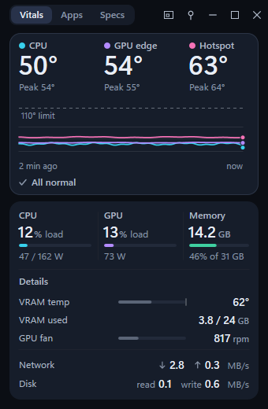
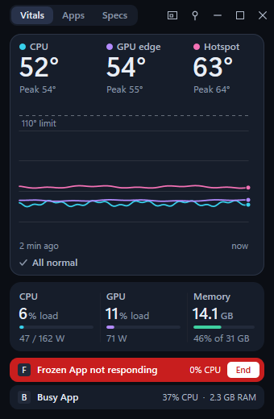
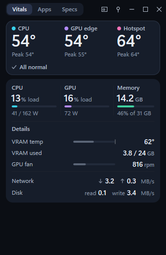
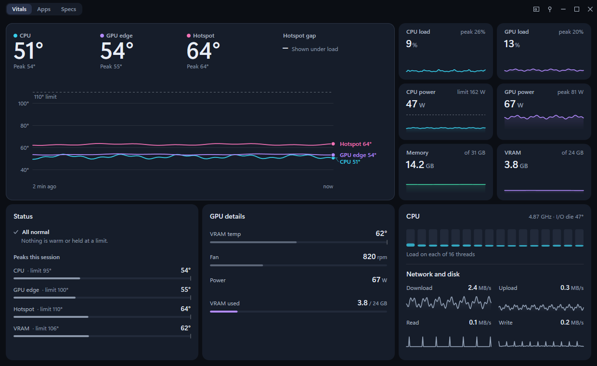
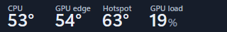
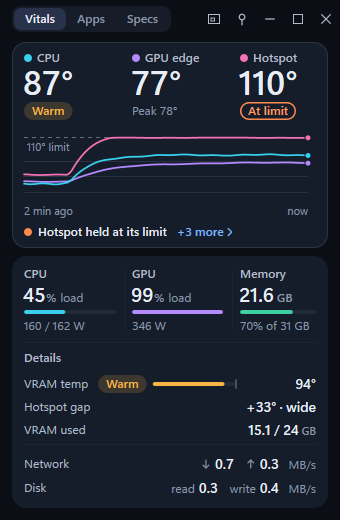
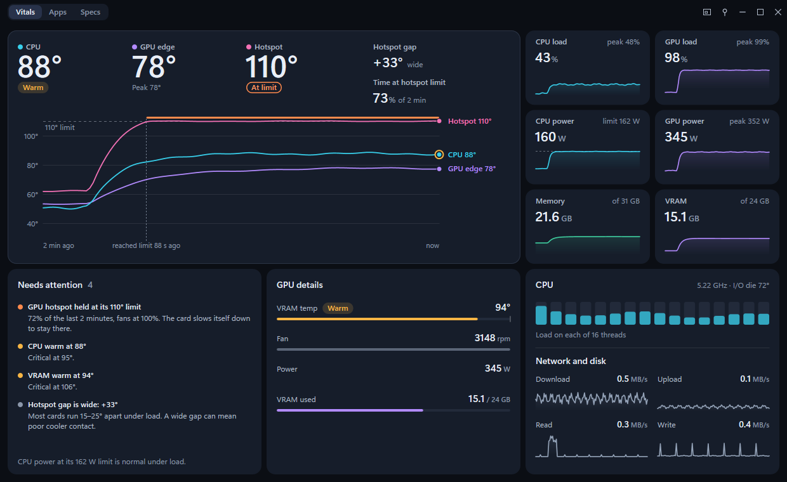
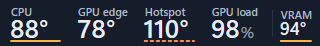
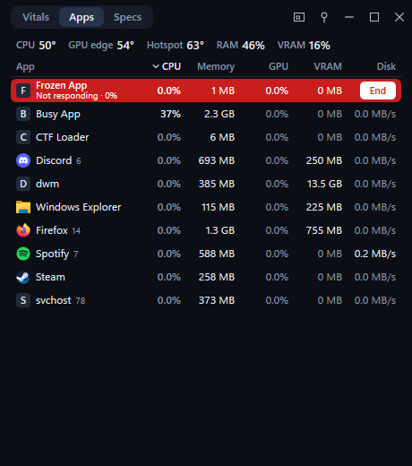
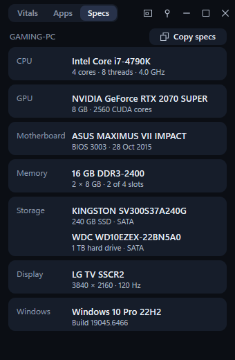

# 🩺 Vitals

A tiny, fully resizable sensor monitor for Windows, written in Rust. One exe of about 700 KB, with nothing to install.

<p align="center">
  
  
</p>

<p align="center"><sub>Sensor screenshots use sample values.</sub></p>

## ⬇️ Download

**[Get the latest release](https://github.com/kyle-barth/vitals/releases/latest)**, download `vitals.exe` and run it.

- 🪟 Needs Windows 10 or 11
- ⚠️ The exe isn't code-signed, so SmartScreen may warn you the first time. Choose **More info**, then **Run anyway**.
- 🔏 Each release is built by GitHub Actions from the tagged source, and lists a SHA-256 hash so you can check your download

## ✨ Features

- 🌡️ **Temperatures:** the CPU, GPU edge and hotspot as big numbers over one 2-minute chart, plus VRAM, each with a session peak. Click a reading to reset its peak.
- 📈 **Live stats:** load, power, memory, disk, network and fan speed, with history lines in a large window
- 🎨 **One colour per part:** CPU cyan, GPU violet, hotspot pink and memory green, everywhere they appear
- 🚦 **Warnings:** Warm adds an amber chip, Hot turns the number orange and frames the card, and Critical puts a red tile behind the reading. Each one is spelled out in words. Serious ones also reach the taskbar, so you can see them while a game covers the window.
- 🎮 **While you play:** a GPU held at its limit says **At limit** calmly, the hotspot's gap from the edge is shown under load, and **Needs attention** lists what's warm or at a limit in plain words
- 🔥 **Busy apps:** only shown when an app is using a lot, with End and a "not responding" warning
- 📋 **Apps view:** every app in a sortable table, like Task Manager
- 🧾 **Specs:** what's in the PC, from CPU to Windows version, with one click to copy it as text
- 🎚️ **Simple or Advanced:** Simple shows just the numbers. Advanced adds the chart and history lines.
- 📌 **Pin:** keeps the window on top. Position, size and pin state are remembered.
- 🚀 **Start with Windows** and 🔔 **Sound on Critical:** two ticks in the menu beside the pin
- 🌗 **Themes:** light and dark, following Windows
- 🪶 **Light:** under 1% of one CPU thread and about 38 MB of memory at the default size

<details>
<summary>🌡️ Temperature limits</summary>

Warm / Hot / Critical:

- **CPU core:** 80° / 90° / 95°
- **CPU I/O die:** 80° / 90° / 100°
- **GPU edge:** 80° / 90° / 100°
- **GPU hotspot:** 95° / 105° / 110°
- **VRAM:** 90° / 100° / 106°

A warning clears once the value is 3° below its limit, so it doesn't flicker. Limits are set in `MetricId::spec` in `src/metrics.rs`.

</details>

## 🎚️ Simple and Advanced

<p align="center">
  
</p>

- 🪟 Window size decides how many things you see. Simple or Advanced decides how much you see about each one.
- 🔢 **Simple** keeps every number, bar and warning, and gives up the history. In a large window the big numbers grow to fill the room the chart leaves.
- 📈 **Advanced** adds the 2-minute chart and the history lines
- 🖱️ Switch between them from the menu beside the pin. Advanced is the default.

## 📐 Any size

- 🗔 **Size menu:** the button beside the pin jumps to Small (320 × 72), Medium (340 × 520) or Large (1240 × 760), and back to your own size. The window stays in its corner of the screen.
- ➖ **Slim strip:** up to about 165 px tall, with fixed slots for the CPU, GPU edge, hotspot and GPU load, and more slots as it widens. Controls appear on hover, and you can drag it from anywhere.
- 📏 **Narrow:** under 240 px wide, with a single column of up to 11 rows
- 🔲 **Compact:** the three temperatures and their chart in one framed card, then a card of readings. A taller window gives the chart the extra height, and a shorter one gives up network and disk first, then the details.
- 🖥️ **Large:** at least 820 × 600, with a chart that has an axis and labels, six readings with history beside it, and cards for what needs attention, the GPU and the CPU, with a bar for every CPU thread



<p align="center">
  
</p>

## 🎮 While you play

<p align="center">
  
</p>

- 🧱 **At limit:** a hotspot at 110°, or an NVIDIA card holding its clocks down for heat, gets an outlined **At limit** chip rather than red. Cards are built to run there under full load, so the number and the frame stay calm.
- 🧮 **CPU at its limit:** cores at 95° stay **Critical**, because on a CPU that usually means the cooler can't keep up. Needs attention says how much of the last 2 minutes they spent there. This needs the core temperature helper.
- ⚡ **Power limits:** a CPU at 97% of its power limit, or an NVIDIA card at its power cap, is normal at full load, so it gets a note rather than a warning
- 🌡️ **Hotspot gap:** on AMD GPUs at 80% load or more, Vitals shows how far the hotspot runs above the edge temperature. Healthy cards often run 15–25° apart.
- ↔️ **Wide** appears once the gap holds at 30° or more for a minute at 90% load, and clears below 27°. A gap that stays wide tends to point at the cooler's contact with the chip, rather than at the game.
- 📋 **Needs attention:** a large window lists everything that's warm, hot or at a limit, worst first, in plain words, such as `GPU hotspot held at its 110° limit: 74% of the last 2 minutes, fans at 100%`. When nothing is, it shows the session's peaks. A smaller window names the worst one under its chart, and **+3 more** opens the large window.
- 📈 **Chart:** a large window marks when the hotspot reached its limit, and labels each line with its reading
- ➖ **Strip:** Warm underlines a slot, At limit dashes the line, Hot outlines the slot and Critical fills it red. A temperature without a slot, such as VRAM, gets the last one while it needs attention.
- 🪟 **Nothing moves or resizes the window on its own**



<p align="center">
  
</p>

## ⚙️ Menu ticks

The menu beside the pin also has two ticks:

- 🚀 **Start with Windows** adds one value to your own Run key. Nothing is installed, and unticking removes it. If you switch Vitals off in Task Manager's Startup apps, the tick follows, and only ticking it again turns it back on.
- 🔐 **At sign-in** Vitals doesn't start the core temperature helper, so signing in never opens on a UAC prompt. Click the CPU reading when you want the core temperature.
- 🔔 **Sound on Critical** is off by default. It plays the Windows warning sound and flashes the taskbar button when a reading turns Critical or an app stops responding, at most once every 10 minutes for each.

## 🔥 Busy apps

The list appears along the bottom of the window only when it's needed. An app is listed once it uses:

- 🧮 **CPU:** 25% of the whole CPU
- 🎮 **GPU:** 25% load
- 🧠 **Memory:** 20% of your RAM
- 🎞️ **Video memory:** 25% of your VRAM
- 🥶 **Not responding:** always, however little it's using

To keep the window calm:

- ⏱️ An app must hold a limit for 5 seconds to appear, and leaves 10 seconds after dropping back
- 🧩 Processes are grouped by exe, so a browser counts as one app
- 📋 Rows keep their order, so End can't shift under your pointer. At most 3 show, or 6 in a wide window.

## 📋 Apps view

<p align="center">
  
</p>

- 🗂️ **Open it** from the Apps tab, or click a row in the Busy list to see that app in the full list
- ↕️ **Sort** by clicking a heading. Click again to reverse it. Frozen apps always stay on top.
- 📏 **Narrow windows** show fewer columns. Click the last heading again to move on to the next one.
- 🎚️ **Simple mode** keeps to CPU and Memory. Advanced shows every column that fits, and each app's process count.
- ✋ **Rows hold still** while your pointer is over the list, so End can't move away from you
- 🔌 **Costs nothing extra when closed:** per-app GPU figures are only read while the table is open, or while the GPU is busy
- 💾 **Disk** counts everything an app reads and writes, which can include network traffic, so it won't always match Task Manager
- 🌐 **There is no Network column**, because there is no cheap way to measure it per app

## 🧾 Specs

<p align="center">
  
</p>

- 🖥️ **Every part:** CPU, GPU, motherboard, memory sticks and slots, each drive, each display and the Windows version. Laptops and prebuilt PCs show their model instead of a board code.
- 📋 **Copy specs**, or Ctrl+C, puts it all on the clipboard as plain lines, ready for a chat or a forum post:
  ```text
  CPU: Intel Core i7-4790K (4 cores, 8 threads, 4.0 GHz)
  GPU: NVIDIA GeForce RTX 2070 SUPER (8 GB)
  Memory: 16 GB DDR3-2400 (2 × 8 GB)
  ```
- 🔍 **More detail with more room:** a large window adds each part's details, such as cache, CUDA cores, PCIe link and BIOS version
- 🪶 **Read once,** the first time the tab opens, so it costs nothing until then

## 🛑 Ending an app

Hover a row in the Busy list or the Apps view to reveal **End**, then confirm. Keep, Esc or clicking elsewhere cancels.

- 💥 **End is immediate:** every process of that app stops at once, and unsaved work is lost
- 🥶 **Frozen apps** show End straight away, with their CPU use. Windows also says "not responding" when an app is only busy, so one still using CPU may recover if you wait, while 0% suggests it's stuck.
- 🔐 **Apps running as administrator** can't be ended, and the row says "Needs admin to end"
- 🛡️ **Windows' own processes** never offer End, because ending one could take down the desktop

## 🌡️ CPU temperature

Windows has no standard API for this. On Intel CPUs it can only be read through a kernel driver, and Vitals installs nothing, so on Intel the CPU's load takes the temperature's place, and other readings take the place of its power. On AMD, Vitals reads what AMD provides:

- 🟡 **Without admin rights:** the CPU reading shows the I/O die, labelled "CPU I/O die". This is not a core temperature.
- 🟢 **Click that reading** for the true core temperature, labelled "CPU". This starts a small helper with admin rights. Windows normally shows a UAC prompt, but if prompts are turned off it happens silently, so the click is the only consent.
- 🔁 **It repeats at each launch** until a prompt is declined. To stop it, set `core_temp=0` in `%APPDATA%\Vitals\settings.ini`. When Windows starts Vitals at sign-in, it waits for a click instead.
- ⚠️ **It relies on an undocumented AMD export** in `Platform.dll`, worked out on a 9800X3D, so an AMD Software update could change it. Every field is range-checked, so the reading would stay on the I/O die rather than show a wrong number.

## 🔒 Security

- 👤 The main app never runs elevated
- 📡 The helper only sends one reading per second down a one-way pipe, and exits as soon as the pipe closes
- 📁 It loads AMD's DLL by full path from Program Files, which only administrators can write to
- 🧱 The exe resolves its DLLs from System32 only, so a malicious DLL sitting in Downloads can't run inside it. That includes AMD's `atiadlxx.dll` and NVIDIA's `nvml.dll`, which their drivers install there.

## 🖥️ Hardware

- ✅ Built and tested on a Ryzen 7 9800X3D with a Radeon RX 7900 XTX, and on a Core i7-4790K with a GeForce RTX 2070 SUPER
- 🌐 Load, memory, disk, network and Specs work on any PC. If Windows is missing its disk or network performance counters, Vitals reads the totals straight from Windows instead.
- 🔴 **AMD GPUs** report everything, including hotspot and memory temperature
- 🟢 **NVIDIA GPUs** report temperature, load, power, clock, fan speed and video memory, through the library that comes with the driver. GeForce cards don't report hotspot or memory temperature, and recent ones give fan speed as a percentage.
- 🔁 **A reading a PC can't report at all** gives its place to another one, such as GPU clock or disk activity, rather than showing a dash forever

## 🛠️ Building

Needs Rust 1.85 or later and the MSVC toolchain with the Windows SDK.

```bash
cargo build --release
```

- 📦 The exe is written to `target/release/vitals.exe`
- 🧪 Run the tests with `cargo test`
- 🩹 If the linker reports `LNK1104`, the project path is too long. Build from a shorter path, or set `CARGO_TARGET_DIR` to one.
- 🏷️ Pushing a version tag runs [the release workflow](.github/workflows/release.yml). Changes are listed in [CHANGELOG.md](CHANGELOG.md).

## 📄 License

Released under the [MIT License](LICENSE).
